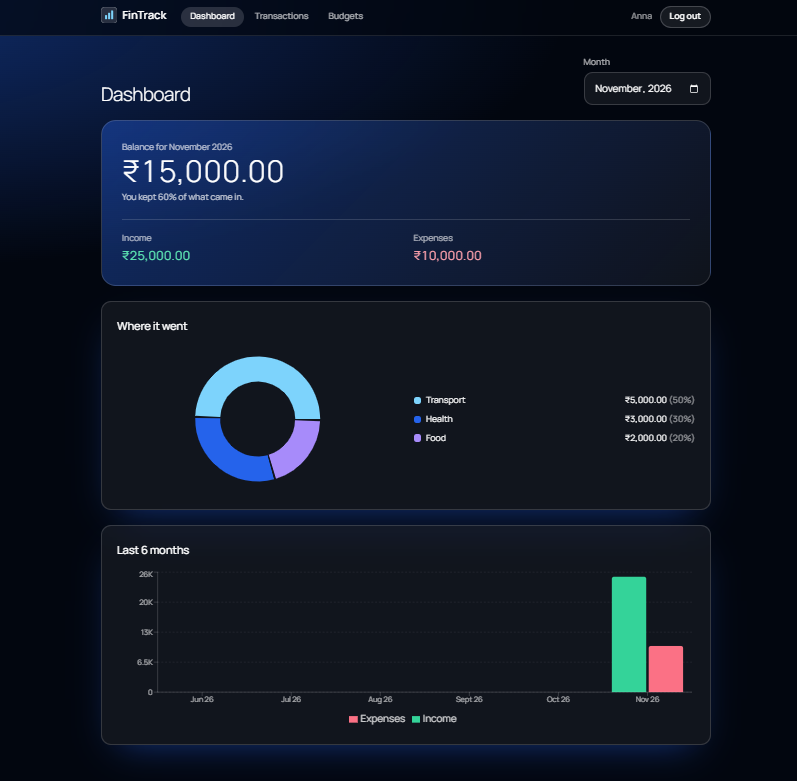

# FinTrack

A full-stack personal finance tracker. Record income and expenses, set monthly budgets per category, and see where your money goes.

[](https://github.com/sushmask1202/fintrack/actions/workflows/ci.yml)

**Live demo:** https://fintrack-pearl-delta.vercel.app



## Features

- Sign up, log in and log out (passwords hashed with bcrypt, JWT sessions)
- Add, edit and delete transactions, with filters (type, category, date range) and pagination
- Monthly budgets per category, with progress bars and warnings at 80% and 100%
- Dashboard with monthly totals, a spending-by-category donut chart and a 6-month trend
- Every user sees only their own data

## Tech stack

| Area | Choice |
|---|---|
| Framework | Next.js 16 (App Router) and TypeScript |
| Database | PostgreSQL on Neon, accessed with Prisma 7 |
| Auth | Auth.js v5 (credentials provider) |
| Validation | Zod |
| Charts | Recharts |
| Styling | Tailwind CSS |
| Tests | Vitest (unit and API) and Playwright (end to end) |
| CI/CD | GitHub Actions, Docker, Vercel |

## Design decisions

- **Per-user data isolation:** every query filters by the user id from the session, never from the request body. Updating or deleting another user's record returns 404.
- **Money is stored as `Decimal(12,2)`**, not floating point, so totals never drift.
- **Input validation on the server** for every route, with a 400 and field-level errors for bad input.
- **Database-side aggregation** for budgets and dashboard totals, so they stay fast as data grows.
- **Tests that guard security rules:** the API tests fail if a route stops filtering by user.

## Run it locally

1. Clone the repo and install dependencies:

   ```bash
   git clone https://github.com/sushmask1202/fintrack.git
   cd fintrack
   npm install
   ```

2. Create a free PostgreSQL database (for example on [Neon](https://neon.tech)) and copy `.env.example` to `.env`, then fill it in:

   ```
   DATABASE_URL="your connection string"
   AUTH_SECRET="a random secret"
   ```

   Generate a secret with: `node -e "console.log(require('crypto').randomBytes(32).toString('base64'))"`

3. Create the tables and start the app:

   ```bash
   npx prisma migrate deploy
   npx prisma generate
   npm run dev
   ```

   Open http://localhost:3000.

## Scripts

| Command | What it does |
|---|---|
| `npm run dev` | Start the dev server |
| `npm run build` | Production build |
| `npm run lint` | Lint the code |
| `npm test` | Unit and API tests (Vitest) |
| `npm run test:e2e` | End-to-end test in a real browser (Playwright) |

## CI/CD

Every push runs lint, tests, a production build and a Docker image build on GitHub Actions. Merges to `main` deploy automatically to Vercel.

## What I would add next

- Rate limiting on login and sign-up
- Recurring transactions and CSV export
- Password reset by email